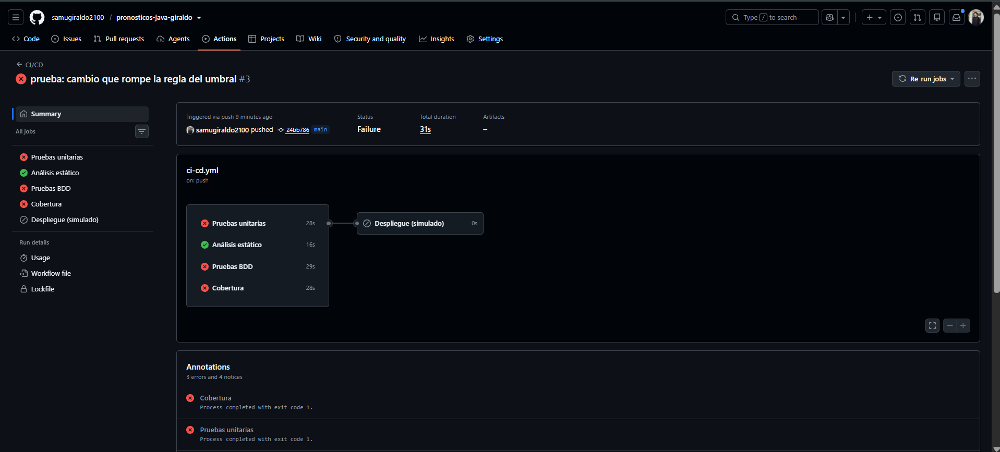
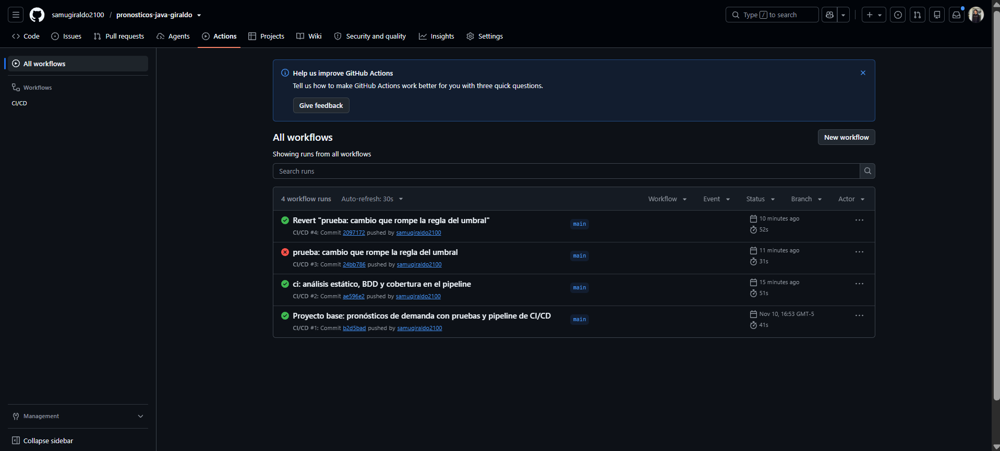
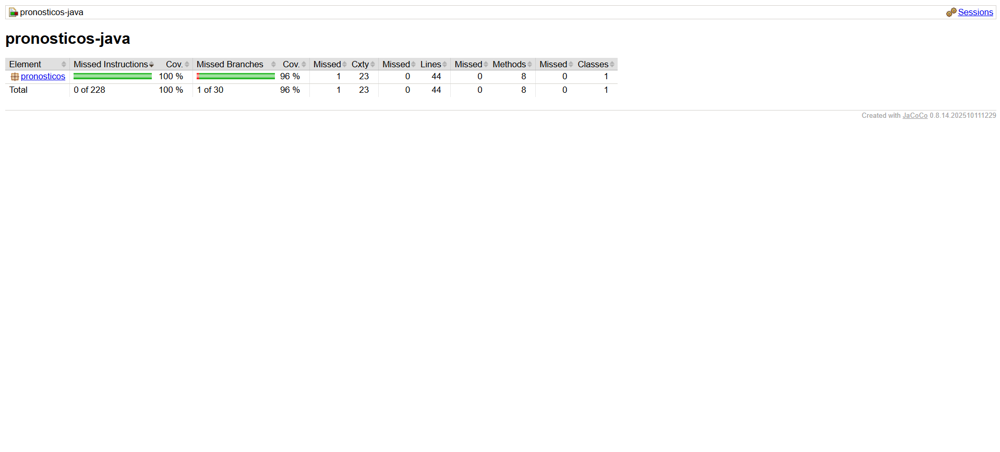

# Informe de la actividad: Pruebas de Software y CI/CD

**Estudiante:** Samuel Esteban Giraldo Betancourt

**Repositorio:** https://github.com/samugiraldo2100/pronosticos-java-giraldo

## 1. Evidencias del pipeline

### 1.1 Pipeline en rojo

### 1.2 Pipeline en verde

## 2. Cobertura de código con JaCoCo

La cobertura obtenida fue del 100 % en instrucciones y del 96 % en ramas, superando el mínimo del 90 % requerido.

## 3. Preguntas y respuestas

### 3.1. ¿Qué vieron en el rojo del Paso 2.1 y por qué en Java suele ser un error de compilación?

En el Paso 2.1 observamos un error de compilación porque la prueba intentaba utilizar el método `suavizacionExponencial`, pero todavía no existía en `CalculadoraPronosticos`. Esto ocurrió porque seguimos TDD, donde primero escribimos una prueba que falla y después implementamos el código necesario para que pase.

### 3.2. ¿Por qué el MAPE del caso [80, 0, 95] se divide entre 2?

El mape se divide entre 2 porque uno de los tres periodos tiene una demanda real igual a cero, este periodo debe excluirse, ya que no podemos dividir entre cero al calcular el error porcentual. Por eso solamente se tienen en cuenta los dos periodos válidos, obteniendo un MAPE aproximado de 2.63 %.

### 3.3. ¿Por qué las pruebas unitarias crean la calculadora con `new` en lugar de levantar Spring?

Utilizamos `new CalculadoraPronosticos()` porque las pruebas unitarias necesitan comprobar el funcionamiento de los métodos de forma independiente. No necesitamos iniciar Spring, ya que estamos probando operaciones y reglas de negocio que no dependen de otros servicios. Esto permite que las pruebas sean más rápidas y sencillas.

### 3.4. ¿Qué diferencia hay entre una prueba unitaria y un escenario BDD en este proyecto?

Las pruebas unitarias verifican directamente el funcionamiento de métodos como `suavizacionExponencial`, `mape` y `debeGenerarAlerta`, utilizando JUnit y sus aserciones.

En cambio, los escenarios BDD describen el comportamiento esperado del sistema mediante frases en español como Dado, Cuando y Entonces. En nuestro proyecto utilizamos Cucumber para comprobar cuándo se debe generar una alerta según el error del pronóstico.

### 3.5. En el Paso 7.5, ¿qué pruebas fallaron y por qué el despliegue no corrió?

Fallaron las pruebas que verificaban que un error igual al umbral debe generar una alerta. Esto ocurrió porque cambiamos intencionalmente el operador `>=` por `>`, haciendo que el sistema dejara de generar una alerta cuando ambos valores eran iguales.

El despliegue no se ejecutó porque configuramos GitHub Actions para que dependiera de que las cuatro verificaciones finalizaran correctamente. Al fallar las pruebas, el pipeline bloqueó el despliegue.

Después utilizamos `git revert` para deshacer el cambio, y el pipeline volvió a quedar en verde.
